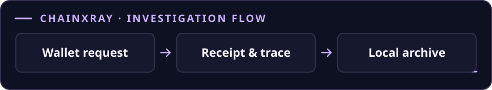

  

  <strong>OFFENSIVE SECURITY &amp; DEVOPS</strong> 
  Investigate systems. Build useful tools. Understand what happens underneath.

  <a href="https://whitewolf217.github.io/white-wolf-portfolio/"><strong>Explore the portfolio ↗</strong></a> &nbsp; / &nbsp;
  <a href="#selected-work">Selected work</a> &nbsp; / &nbsp;
  <a href="#hack-the-box--ctfs">HTB &amp; CTFs</a> &nbsp; / &nbsp;
  <a href="https://www.linkedin.com/in/nitish-matta-b1545930b/">LinkedIn</a>

---

I’m **White Wolf** — an offensive security practitioner, tool builder, and ECE student at LNMIIT. I work on **Active Directory, web and API security, and reverse engineering**, compete in CTFs, and lead hands-on security practice with Cipher.

I’m also growing my **DevOps** experience through Kubernetes, Helm, containers, cloud infrastructure, and CI/CD, bringing that work together with security through **DevSecOps**.

## Selected work

### 01 / ChainXray
**Flagship · Ethereum transaction investigation**

A Windows desktop workbench that connects a wallet request to its on-chain outcome. Inspect decoded inputs, compare receipts and contract traces, and retain investigation records in a local SQLite archive. Signing stays in the wallet.

`Tauri` `TypeScript` `Ethereum` `SQLite`  
[Source & documentation ↗](https://github.com/WhiteWolf217/ChainXray)

### 02 / SPECTRE
**Red-team research · Local LLMs**

Research into coordinating authorized red-team engagements with a locally run language model. The workflow brings together planning, operator-reviewed tool runs, and engagement reporting mapped to MITRE ATT&CK.

[Explore SPECTRE in the portfolio ↗](https://whitewolf217.github.io/white-wolf-portfolio/#spectre)

### More hands-on work

| Project | What I built |
| :--- | :--- |
| **Graph-based intrusion detection** | DA-IICT research using CICIDS2017 and live network traffic. [Live prototype](https://github.com/WhiteWolf217/RealTime-Intrusion-Detection-GNNs) · [Offline prototype](https://github.com/WhiteWolf217/Static-Intrusion-Detection-GNNs) |
| **OT syslog pipeline** | One-way logging through a Fend optical data diode, with a live dashboard. |
| **MetaDefender on Kubernetes** | A Helm deployment with in-cluster PostgreSQL, storage fixes, and deployment documentation. |
| **PhantomNet** | ESP8266-based Wi-Fi security research in controlled lab environments. |
| **LNMHacks 8.0** | Isolated Docker challenge environments deployed and managed on Google Cloud. |

[Project details and experience ↗](https://whitewolf217.github.io/white-wolf-portfolio/#projects)

## Hack The Box & CTFs

### Competition highlights

| Event | Result | Evidence |
| :--- | :--- | :--- |
| **Holmes CTF 2026** | **111/111 tasks solved solo** · 8,725 points · **139 / 5,637 teams** | [Certificate](https://drive.google.com/file/d/1P8ivv7gBUrEot4oGevLgUziNCAv8m_-o/view?usp=sharing) · [Event](https://ctf.hackthebox.com/event/details/holmes-ctf-2026-the-reichenbach-directive-3504) |
| **Operation Cymbal: Cold Room** | **18/18 challenges solved solo** · 2,075 points · **222 / 1,677 teams** | [Certificate](https://drive.google.com/file/d/1FLc2rZliHVuz48mrnDVTF3WSChX9YP7L/view?usp=sharing) · [Event](https://ctf.hackthebox.com/event/details/operation-cymbal-cold-room-3631) |
| **FamPay Security CTF** | **33rd place** · **1,850/1,850 points** · All six challenges solved | [Scoreboard](https://ctf.fampay.co/scoreboard) |
| **HTB University CTF 2025** | **363 / 1,014 teams** · 18/34 challenges solved with LNMIIT | Team participation |

<strong>Selected earned badges · Five Academy paths completed</strong>

- **Comfortably Numb** — HTB Labs milestone for owning 20 machines.
- **Stand above all** — Completed the Local Privilege Escalation path.
- **Enumerate & Attack! · AD Security Captain** — Active Directory enumeration and Windows security modules.
- **Endpoint Explorer · Graph invader** — API security and GraphQL testing modules.

[View earned badges ↗](https://profile.hackthebox.com/profile/019c8a07-e0c4-7293-a1a2-f0b469ed1f0f?tab=badges)

## In the field

**NOW · Cipher, LNMIIT — Cybersecurity Coordinator**  
Mar 2026 – Present · Lead workshops, mentor peers, and run CTF practice. Deployed isolated challenge infrastructure for LNMHacks 8.0.

**OPSWAT–Pelorus project — Network Engineering Intern**  
Jul – Aug 2026 · Built one-way OT log forwarding and file-transfer automation across a data diode. Deployed MetaDefender Core with Helm and Kubernetes.

**DA-IICT — Cybersecurity Research Intern**  
May – Jul 2025 · Researched graph neural networks for intrusion detection using CICIDS2017 and live network traffic.

## DevSecOps in practice

| Hands-on experience | Currently developing |
| :--- | :--- |
| **Kubernetes & Helm** — MetaDefender Core with PostgreSQL | Kubernetes administration and CKA preparation |
| **Docker & Google Cloud** — Isolated CTF environments | Cloud infrastructure and repeatable deployments |
| **GitHub Actions** — This portfolio’s build and deployment | Integrating security checks into delivery pipelines |

**Toolkit**  
Security · Active Directory, Burp Suite, Wireshark, Ghidra  
Infrastructure · Kubernetes, Helm, Docker, Google Cloud, GitHub Actions, OT data diodes  
Development · Python, TypeScript, Java, Bash, PowerShell

## Credentials & learning

- **CNSP & CBTP, with merit** — The SecOps Group.
- **CPTS & CKA** — Preparation in progress.
- **B.Tech, Electronics and Communication Engineering** — LNMIIT, expected 2028.
- **Amazon ML Summer School 2026** — Shortlisted among the top 3,000 applicants.

---

  <strong>Let’s build something.</strong> 
  Open to security internships, research collaborations, and CTF teams.  
  <a href="https://whitewolf217.github.io/white-wolf-portfolio/">Portfolio</a> &nbsp; / &nbsp;
  <a href="https://www.linkedin.com/in/nitish-matta-b1545930b/">LinkedIn</a> &nbsp; / &nbsp;
  <a href="https://profile.hackthebox.com/profile/019c8a07-e0c4-7293-a1a2-f0b469ed1f0f">Hack The Box</a>

