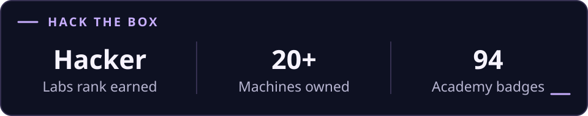

  

  <strong>Offensive security · Active Directory · Web and API testing · Reverse engineering</strong> 
  <a href="#hack-the-box--ctfs">Hack The Box &amp; CTFs</a> ·
  <a href="#selected-work">Selected work</a> ·
  <a href="https://whitewolf217.github.io/white-wolf-portfolio/">Portfolio</a> ·
  <a href="https://www.linkedin.com/in/nitish-matta-b1545930b/">LinkedIn</a>

I’m White Wolf. I practice offensive security in authorized labs, compete in CTFs, and build tools for security investigations. My focus is Active Directory, web and API testing, and reverse engineering. I'm an ECE student at LNMIIT and coordinate cybersecurity workshops and CTF practice with Cipher.

## Hack The Box & CTFs

### Selected earned badges

- **Comfortably Numb** · HTB Labs milestone for owning 20 machines.
- **Stand above all** · Completed the Academy **Local Privilege Escalation** path, one of five completed paths.
- **Enumerate & Attack!** and **AD Security Captain** · Completed Academy modules in Active Directory enumeration and Windows security.
- **Endpoint Explorer** and **Graph invader** · Completed Academy modules in API security and GraphQL testing.

### Competition results

| Event | Result |
| --- | --- |
| **[HTB Holmes CTF 2026](https://www.hackthebox.com/events/holmes-2026)** | **111/111 tasks solved solo** · 8,725 points · 139th of 5,637 teams |
| **FamPay Security CTF** | **1,850/1,850 points** · All six challenges solved |
| **HTB University CTF 2025** | **363rd of 1,014 teams** · 18 of 34 challenges solved with LNMIIT |

## Selected work

### ChainXray · Ethereum transaction investigation

I built a Windows workbench for reviewing an Ethereum wallet request alongside the receipt and contract trace. It decodes supported requests and keeps investigation records in a local SQLite archive. Transaction signing stays in the wallet.

**Tauri · TypeScript · Ethereum · SQLite**  
[Source code and project documentation](https://github.com/WhiteWolf217/ChainXray)

### SAST-JAVA · Static application security testing

A lightweight Java source scanner built with JavaParser and Maven. It flags common security issues for review, including SQL injection and unsafe command execution patterns.

[Source code](https://github.com/WhiteWolf217/SAST-JAVA)

### Intrusion detection with graph neural networks

At DA-IICT, I prototyped two ways to classify network flows: offline evaluation on CICIDS2017 data and live traffic monitoring. Both model network connections as graphs so the classifier can use relationships between hosts and flows.

[Real-time prototype](https://github.com/WhiteWolf217/RealTime-Intrusion-Detection-GNNs) · [Offline evaluation](https://github.com/WhiteWolf217/Static-Intrusion-Detection-GNNs)

## Experience & credentials

- **OPSWAT–Pelorus · Network Engineering Intern** — Built one-way OT log forwarding and file transfer automation across a data diode. Deployed MetaDefender Core on Kubernetes.
- **Cipher, LNMIIT · Cybersecurity Coordinator** — Lead workshops and CTF practice. Deployed isolated Docker challenge environments on Google Cloud for LNMHacks 8.0.
- **The SecOps Group** — [Certified Network Security Practitioner](https://pentestingexams.com/certifications/essentials/certified-network-security-practitioner/) and [Certified Blue Team Practitioner](https://pentestingexams.com/certifications/essentials/certified-blue-team-practitioner/), both earned with merit.

[Hack The Box profile](https://profile.hackthebox.com/profile/019c8a07-e0c4-7293-a1a2-f0b469ed1f0f) · [Browse repositories](https://github.com/WhiteWolf217?tab=repositories)
